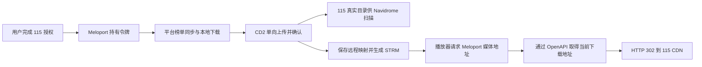

# Meloport 接入 115 OpenAPI 与 STRM

2026-11-21 · 首版已实现，本地模拟验证与真实账号联调分开记录。

首版用环境变量注入 Access Token。Meloport 将校验完成的音频同卷移入 CD2 暂存目录，定时通过 115 OpenAPI 核对远程文件并生成 STRM。Meloport 提供独立媒体监听，可选接入 Subsonic 反代。配置与命令见 [README](../README.md#115-网盘cd2-与-strm)。自动续期、PKCE 扫码、真实播放器的首播与拖动仍待联调。首版每次请求获取新的临时直链，等 115 直链有效期得到验证后再评估缓存。

## 目标与首版范围

复用 OpenList 使用的 115 开放平台 AppID，免去自行申请应用。CD2 负责本地暂存目录到 115 的单向上传，并把 115 目标目录挂载为真实文件系统供 Navidrome 扫描。Meloport 负责榜单同步、音频下载和标签处理，直接使用 115 OpenAPI 读取远程文件映射、取得临时下载地址和提供 STRM 302 播放入口；运行时不部署 OpenList。

首版以现有平台订阅任务为生产者：本地音频下载和标签处理成功后，写入 CD2 监控的暂存目录；CD2 报告上传完成后，Meloport 通过 115 OpenAPI 确认远程文件并建立映射，再生成或更新本地 STRM。源文件的删除只能由 CD2 的“上传完成后删除源文件”规则执行，不能由 Meloport 在上传尚未确认时直接删除。网盘只保留 Meloport 自己写入的远程目录，不自动删除远端文件。

Navidrome 扫描的是 CD2 挂载的 115 真实音频目录，不是 STRM 目录。这样它仍能读取 MP3、FLAC、M4A 等文件中的标签和格式信息；STRM 仅作为给其他支持 STRM 的播放器使用的额外导出。

## 授权方式

OpenList 官方公开授权入口当前使用的 115 `client_id` 为 **`100197303`**，于 2026-11-21 从返回的公开登录地址核对。应用 ID 可作为配置输入。用户完成授权后生成的 Access Token 和 Refresh Token 才是访问其网盘的凭据。OpenList 实例里的存储 ID 用于标识挂载记录，115 的 `cid` 用于标识目录。 [官方公开授权入口](https://api.oplist.org/115cloud/requests?driver_txt=115cloud_go&server_use=true)

| 阶段 | 操作 | 验证状态 |
| --- | --- | --- |
| 首次联调 | 仅使用 `api.oplist.org` 的授权页面选择 115 网盘验证登录，勾选「使用 OpenList 提供的参数」，完成授权后将专门为 Meloport 的读取和播放获取的令牌交给本地进程。运行时不依赖 OpenList 实例；CD2 单独管理自己的 115 连接。 | 官方流程与源码已核对，尚未使用账号实测。 |
| 内建扫码 | 配置 AppID，由 Meloport 后端生成随机 `code_verifier`，调用 115 申请二维码，等待用户确认，再发起换令牌请求。SDK 已实现这套 PKCE 流程，客户端无需 AppSecret。 | SDK 实现已核对。`100197303` 能否在独立客户端完成 PKCE 并取得所需权限，待实测。 |

官方授权页使用 OAuth 授权码模式，AppID 和 AppSecret 由 OpenList 授权服务器提供，首次换取令牌经过该服务。将令牌交给 Meloport 后，列目录、取得下载地址和刷新令牌均可请求 115 的域名。若内建扫码验证失败，首版可以继续使用官方页授权与本地导入。 [OpenList 115 Open 文档](https://doc.oplist.org/guide/drivers/115_open) · [官方授权服务实现](https://github.com/OpenListTeam/OpenList-APIPages/blob/4322fd1f0f5e4e77454fd8a5edb89727854b0092/src/driver/115cloud_oa.ts#L16) · [PKCE SDK 实现](https://github.com/OpenListTeam/115-sdk-go/blob/v0.2.6/auth.go)

### OpenAPI 调用清单

| 操作 | 已核对的请求 | 关键输入 |
| --- | --- | --- |
| 网页授权 | `GET https://passportapi.115.com/open/authorize` | `client_id`、`redirect_uri`、`state` |
| 网页授权码换令牌 | `POST https://passportapi.115.com/open/authCodeToToken` | 授权码与服务端应用凭据 |
| PKCE 申请二维码 | `POST https://passportapi.115.com/open/authDeviceCode` | `client_id`、`code_challenge`、`code_challenge_method=sha256` |
| PKCE 查询扫码状态 | `GET https://qrcodeapi.115.com/get/status/` | 二维码会话的 `uid`、`time`、`sign` |
| PKCE 换令牌 | `POST https://passportapi.115.com/open/deviceCodeToToken` | `uid`、`code_verifier` |
| 刷新令牌 | `POST https://passportapi.115.com/open/refreshToken` | `refresh_token` |
| 验证授权 | `GET https://proapi.115.com/open/user/info` | Access Token |
| 分页列目录 | `GET https://proapi.115.com/open/ufile/files` | Access Token、`cid`、`offset`、`limit` |
| 获取上传凭据 | `GET https://proapi.115.com/open/upload/get_token` | Access Token |
| 初始化上传 | `POST https://proapi.115.com/open/upload/init` | 文件名、大小、SHA-1、目标 `cid` |
| 断点或分片上传 | `POST https://proapi.115.com/open/upload/resume` 及返回的对象存储地址 | 上传会话和分片信息 |
| 获取文件下载地址 | `POST https://proapi.115.com/open/ufile/downurl` | Access Token、`pick_code`、User-Agent |

网盘业务请求使用 `Authorization: Bearer <Access Token>`。扫码状态是授权过程的辅助接口，列文件与取地址由开放平台的 `/open/` 接口处理。 [SDK 接口定义](https://github.com/OpenListTeam/115-sdk-go/blob/v0.2.6/const.go) · [文件请求实现](https://github.com/OpenListTeam/115-sdk-go/blob/v0.2.6/fs.go)

### 凭据生命周期

- 首次连通验证可以从环境变量注入短期 Access Token，只调用用户信息、列文件和取地址。配置文件记录 AppID、目录和凭据引用等设置项。
- 常驻运行需要持久化轮换后的令牌。一个授权记录只由 Meloport 一个进程负责刷新，同一进程内将并发刷新合并，成功后立即持久化新令牌。不要让其他客户端或服务共享并刷新这份令牌。令牌失效时提示重新授权。
- 实现常驻续期前，先确定凭据后端以及它与项目环境变量规则的衔接。可评估系统凭据存储或外部密钥存储。普通 YAML、业务 SQLite、STRM、日志及 API 响应只保留配置、状态与脱敏信息。

OpenList 驱动源码明确说明刷新令牌轮换后旧值会失效。 [OpenList 刷新处理](https://github.com/OpenListTeam/OpenList/blob/7c26f1012c2951441233dce4ef309753fc76165d/drivers/115_open/driver.go#L43)

## 扫描与播放

1. **同步和上传。** 平台榜单同步仍由现有任务完成。下载、标签和本地完整性检查成功后，文件进入 CD2 监控的暂存目录。CD2 负责单向上传、队列、限速、重试和断点；只在确认上传完成后才删除源文件。Meloport 通过 CD2 任务状态或 115 目录 API 确认远端文件 ID、大小和哈希后，才标记为远程可用。
2. **映射。** 本地数据库保存 `task_id`、平台歌曲 ID、暂存路径、115 `cid`、文件 ID、`pick_code`、远程路径、文件哈希、CD2 上传状态、远程完成状态和稳定播放 ID。若 CD2 删除暂存文件，数据库仍保留远程映射。**下一轮 Meloport 同步必须识别远程完成状态，不能因本地文件不存在而重新下载歌曲。** 临时 CDN URL 不持久化。
3. **元数据扫描。** Navidrome 的音乐库目录指向 CD2 挂载的 115 真实目录。首次或定期扫描会通过 CD2 读取远程文件的标签和格式；扫描速度、API 请求量和网络依赖高于本地磁盘。CD2 上传完成后再触发或等待 Navidrome 扫描，避免扫描到未完成文件。
4. **导出。** 在独立目录按任务或专辑生成 STRM。文件内容是一行 UTF-8 的稳定 Meloport 媒体地址，例如 `https://media.example.net/media/ab12cd34`。扫描或重试只更新缺失或内容变化的 STRM，不因远端歌单变化删除已上传文件。
5. **Navidrome 302。** Navidrome 扫描 CD2 挂载路径下的真实文件，读取 ID3/Vorbis 等标签并建立曲目记录。客户端播放请求必须经过 Meloport 中 MusicWarp 风格的 Navidrome 透明反代；Meloport 拦截 Subsonic 播放请求，通过 Navidrome 歌曲 ID/真实路径找到已持久化的 115 映射，调用 `downurl` 后返回 `HTTP 302`。直接连 Navidrome 会从 CD2 挂载读取音频，不会触发这条 302。
6. **STRM 播放。** 面向不使用 Navidrome、但支持音频 STRM 的客户端时，STRM 指向 Meloport 稳定媒体路由。媒体接口根据稳定播放 ID查询映射，用当前 `pick_code` 和请求中的 User-Agent 调用 `downurl` 并返回 `HTTP 302 Location`。缓存只保存短期直链，且不能超过 115 直链有效期。若 CDN 对 Range 或 User-Agent 有限制，再增加受控代理回退；首版先验证 302、拖动和断点续播。
7. **访问。** `server.listen` 继续作为回环管理入口，新增独立的媒体/反代监听配置，或由外部 HTTPS 反向代理暴露播放入口。STRM 中填写播放器实际可到达的媒体 URL，媒体入口必须有访问控制或不可猜测的稳定 ID。

Navidrome 目前不支持把音频 STRM 当作曲库文件。STRM 需要交给支持该格式的播放器或媒体程序；Meloport 的媒体入口本身不依赖 Navidrome。 [Navidrome 官方讨论](https://github.com/navidrome/navidrome/discussions/5296)

## MusicWarp 借鉴边界

MusicWarp 只作为代码模式参考，不作为独立运行时服务。把需要的媒体 handler 和直链缓存能力实现到 Meloport 自己的 Go 服务中。参考 `E:\project\musicwarp\musicwarp\internal\handler\stream.go` 的 302 处理与临时缓存，及 `E:\project\musicwarp\musicwarp\internal\service\openlist.go` 中“先解析下载地址，再返回给 handler”的职责拆分；其 OpenList 客户端需替换为 Meloport 的 115 OpenAPI 客户端。不要引入它对 Navidrome Song ID、Navidrome 真实路径、OpenList `/api/fs/get` 的依赖；Meloport 已经拥有自己的歌曲元数据和 115 远程映射。

管理接口当前只允许回环监听。媒体接口应由同一 Meloport 进程的独立监听配置提供，或由外部 HTTPS 反向代理安全暴露。随机不透明媒体 ID 是可转发的播放凭据：持有 STRM 链接的人可以播放对应文件，应使用 HTTPS、避免在日志中记录完整 URL，并保护本地 STRM 文件。

## Meloport 实现顺序

| 顺序 | 实现内容 | 当前参考位置 |
| --- | --- | --- |
| 1 | 封装 115 连接与凭据读取，先验证 `UserInfo`、`List` 和 `DownURL` | `tmp/references/115-sdk-go/` 和 `tmp/references/openlist/drivers/115_open/`（仅作 API 参考） |
| 2 | 对接 CD2 上传完成状态，增加远程文件映射和源文件保留/清理状态 | `internal/config/config.go`、`internal/app/`、`internal/state/` |
| 3 | 增加远程完成记录；本地暂存文件被清理后，普通歌单同步必须从 115 远程状态恢复，不重复解析下载 | `internal/syncer/syncer.go`、`internal/state/` |
| 4 | 增加 Navidrome 透明反代、播放请求拦截、独立 STRM 写入与稳定媒体 302 入口 | `internal/syncer/syncer.go`、`internal/download/`、`internal/app/`、`internal/state/` |
| 5 | 验证凭据轮换、定时同步、Range/UA 和目标播放器，再决定是否集成 PKCE 扫码 UI | `tmp/references/115-sdk-go/auth.go` 与 `tmp/references/openlist-api-pages/src/driver/115cloud_oa.ts`（仅作授权参考） |

本地参考仓库位于 Git 忽略的 `tmp/references/`。对应版本为 OpenList `7c26f10`、OpenList-APIPages `4322fd1`、115 Go SDK `v0.2.6`。这些目录只供查阅，独立检出时可按上面的上游链接获取对应源码。

## 接入验收

本地测试覆盖分页读取、未完成文件过滤、标签未完成时保留工作文件、远程文件大小与哈希核对、清理源文件后续同步、重启后恢复同一 STRM 链接，以及 Subsonic 请求鉴权、302 和回源。

- [ ] **授权与读取。** 使用官方页预设参数取得专用令牌，对一个含有自有测试音频的小目录验证用户信息、分页文件列表和 `downurl`。记录结果、状态码与文件数量，测试输出中省略令牌和临时地址。
- [ ] **上传与导出。** 覆盖中文与空格、同名不同扩展、安全路径、CD2 上传中断和重试。确认远程文件可读后才生成 `.strm`；确认 CD2 完成后再删除源文件，重复运行不重复上传。
- [ ] **远程元数据。** 让 Navidrome 扫描 CD2 挂载的真实 115 音频，验证标签、封面、格式和重新扫描行为；确认 Navidrome 不把 STRM 当作音乐文件。
- [ ] **远程续同步。** CD2 删除暂存音频后重跑 Meloport 同一榜单任务；确认按远程完成记录跳过解析/下载/重复上传。
- [ ] **真实播放。** 验证 Navidrome 客户端经 Meloport 反代请求能得到 302，且首播、拖动、暂停后续播和服务重启后映射仍有效。再验证 STRM 客户端的稳定媒体 URL；验证 Range 返回符合预期，取得新下载地址后仍使用原有入口。
- [ ] **续期。** 本地模拟服务覆盖令牌轮换、多个请求同时触发刷新、持久化失败和重启读取新令牌。真实账号另验证至少一次成功刷新。
- [ ] **独立扫码。** 使用 `100197303` 单独验证设备码申请、扫码、换令牌，以及用新令牌列目录和取地址。根据实际结果决定内建扫码是否可发布。
